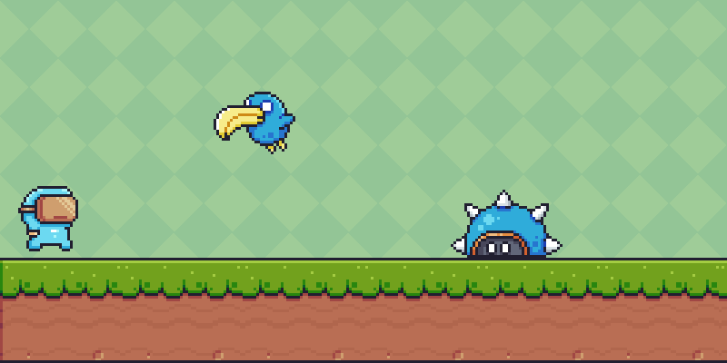

# Visualized



A 2D infinite platformer built with Python and Pygame.
Run as far as you can, collect coins, and unlock characters and sky themes.

## Controls

| Action | Keyboard | Notes |
|--------|----------|--------|
| Jump | W / Space / ↑ | Also left mouse button |
| Move | A/D or ←/→ | |
| Down | S / ↓ | |
| Pause | Esc | |
| Confirm | Enter | |
| Controller | Supported | Same actions via gamepad |

## Run

```bash
pip install -r requirements.txt
python main.py
```

Python 3.x · Pygame 2.x

## Stack

- Python + [Pygame](https://www.pygame.org/)
- Custom handlers for player, enemies, coins, UI, audio, controller
- Pixel art assets + chiptune soundtrack

## License

See [LICENSE](LICENSE).
